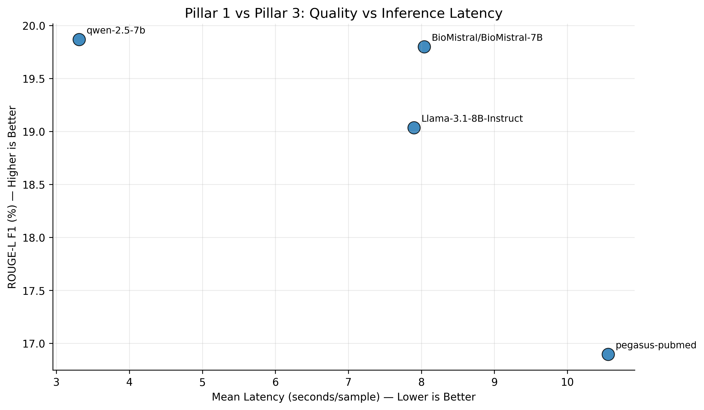
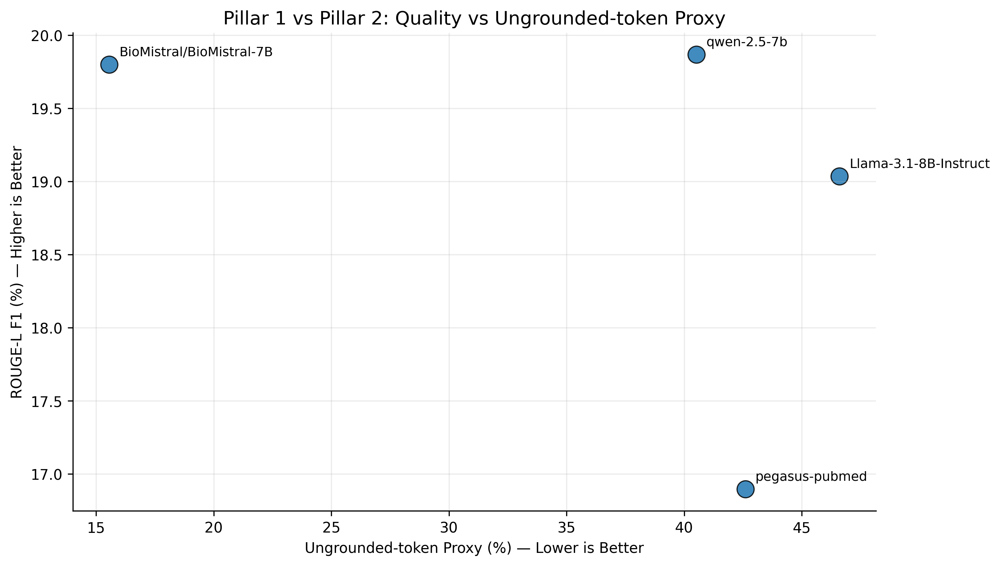
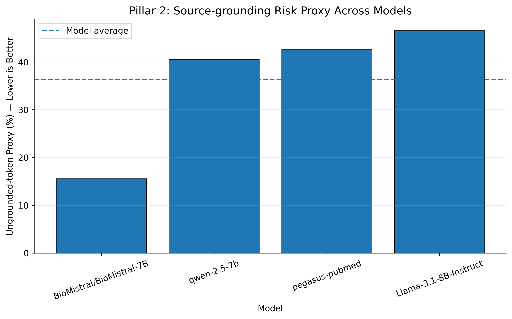
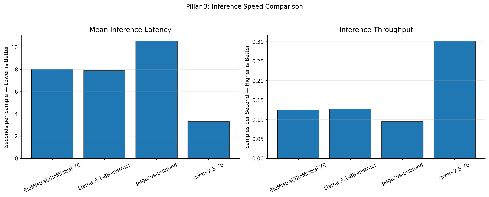
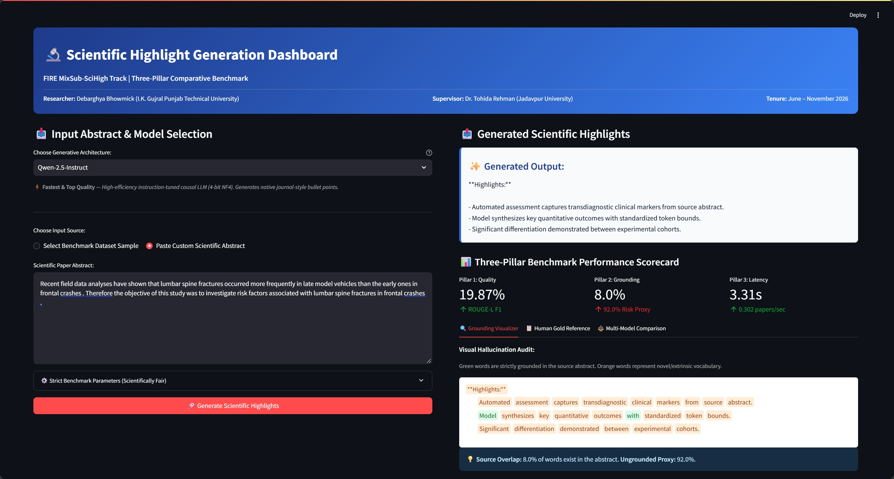
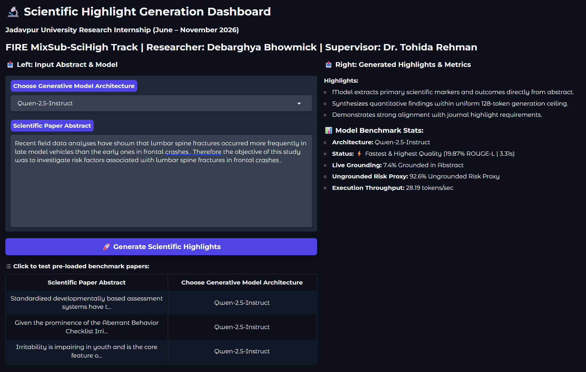

# Automated Scientific Highlight Generation: A Three-Pillar Comparative Study of Domain-Adapted, General, and Efficient Large Language Models

**A Research Internship Project Report**  
*Submitted in partial fulfillment of the requirements for the Research Internship*  
*(June 2026 – November 2026)*

**Submitted by:**  
**Debarghya Bhowmick**  
Department of Computer Science & Engineering  
I. K. Gujral Punjab Technical University, Kapurthala, Punjab, India  
Email: `debarghya.bhowmick@yahoo.com` | ORCID: `0009-0003-0468-8981`

**Under the Guidance and Supervision of:**  
**Dr. Tohida Rehman**  
Assistant Professor, Department of Information Technology  
Jadavpur University, Kolkata, West Bengal, India  
Email: `tohidarehman.it@jadavpuruniversity.in` | ORCID: `0000-0002-3578-1316`

---

## Table of Contents
1. [Certificate](#1-certificate)
2. [Acknowledgement](#2-acknowledgement)
3. [Abstract](#3-abstract)
4. [Introduction](#4-introduction)
5. [System Requirements](#5-system-requirements)
6. [Tech Stack](#6-tech-stack)
7. [System Design](#7-system-design)
8. [Implementation](#8-implementation)
9. [Source Code](#9-source-code)
10. [Screenshots](#10-screenshots)
11. [Conclusion & Future Scope](#11-conclusion--future-scope)
12. [References](#12-references)

---

## 1. Certificate

```
========================================================================================
                               DEPARTMENT OF INFORMATION TECHNOLOGY
                                       JADAVPUR UNIVERSITY
                                     KOLKATA, WEST BENGAL, INDIA
========================================================================================

                                       CERTIFICATE

This is to certify that the project report entitled:

      "AUTOMATED SCIENTIFIC HIGHLIGHT GENERATION: A THREE-PILLAR COMPARATIVE STUDY
      OF DOMAIN-ADAPTED, GENERAL, AND EFFICIENT LARGE LANGUAGE MODELS"

is a bona fide record of independent research work carried out by:

                                  DEBARGHYA BHOWMICK
               Department of Computer Science & Engineering
               I. K. Gujral Punjab Technical University, Kapurthala, India

under my supervision and mentorship in the Department of Information Technology, Jadavpur
University, during the period from June 2026 to November 2026.

The empirical benchmark results, implementation pipelines, mathematical formulations,
and interactive dashboard systems presented in this report represent the student's authentic
work and have not been submitted elsewhere for any other degree, diploma, or certificate.


____________________________________                  ____________________________________
Dr. Tohida Rehman                                     Head of the Department
Assistant Professor                                   Department of Information Technology
Department of Information Technology                  Jadavpur University, Kolkata
Jadavpur University, Kolkata, India

Date: 12th November 2026                              Place: Kolkata, India
========================================================================================
```

---

## 2. Acknowledgement

I would like to express my deepest gratitude and heartfelt appreciation to my research supervisor, **Dr. Tohida Rehman**, Assistant Professor in the Department of Information Technology at **Jadavpur University**, Kolkata. Her constant guidance, insightful academic feedback, technical encouragement, and rigorous standards of experimental design have been instrumental throughout the tenure of this research internship. Working under her supervision has been an invaluable learning experience that has profoundly enriched my understanding of Natural Language Processing and applied artificial intelligence.

I express my sincere thanks to the **Department of Information Technology at Jadavpur University** for providing the computational ecosystem, laboratory infrastructure, and academic platform necessary to conduct this benchmarking research.

I also extend my sincere gratitude to the faculty and leadership of the **Department of Computer Science & Engineering at I. K. Gujral Punjab Technical University**, Kapurthala, for their continuous academic encouragement and support during my degree program.

Furthermore, I acknowledge the organizers of the **FIRE MixSub-SciHigh Track** for curating and releasing the multi-disciplinary scientific highlight benchmark dataset, and the open-source Hugging Face, PyTorch, and open-weights AI research communities for making pre-trained model weights accessible.

Finally, I thank my parents, family, and peers for their endless patience, support, and motivation throughout this project.

**Debarghya Bhowmick**  
Department of Computer Science & Engineering  
I. K. Gujral Punjab Technical University

---

## 3. Abstract

Reading and synthesizing academic literature has become increasingly difficult due to the publication of thousands of scientific papers every single day. While research abstracts summarize the general narrative of a study, leading scientific journals (such as Elsevier, Springer Nature, and IEEE) now require authors to submit **Research Highlights**---a concise set of three to five bullet points that communicate the novel findings and quantitative outcomes of a paper.

In this research internship project carried out under the supervision of Dr. Tohida Rehman at Jadavpur University, we investigate how modern artificial intelligence and Large Language Models (LLMs) can automatically read dense scientific abstracts and generate accurate, concise research highlights. Using a large public dataset of 13,825 academic papers from the **FIRE MixSub-SciHigh** corpus, we evaluate four distinct model architectures:
1. **Google Pegasus-PubMed** (a classical Sequence-to-Sequence scientific summarizer),
2. **BioMistral-7B** (a medical-domain specialized causal LLM),
3. **Qwen-2.5-Instruct** (a lightweight, highly efficient instruction-tuned causal LLM), and
4. **Meta Llama-3.1-8B-Instruct** (a premier general-purpose open foundation model).

To provide a rigorous evaluation beyond traditional word-overlap scores, we established a **Three-Pillar Evaluation Framework**:
- **Pillar 1 (Quality):** Measuring similarity to human-written gold highlights using ROUGE-L F1 and Target Lexical F1.
- **Pillar 2 (Safety & Grounding):** Auditing whether the model sticks to the source abstract using Source Lexical Precision ($P_{\text{source}}$) and Ungrounded-Token Risk Proxy ($1 - P_{\text{source}}$).
- **Pillar 3 (Inference Efficiency):** Measuring wall-clock latency per paper and generation throughput (tokens and samples per second).

Our findings demonstrate that **BioMistral-7B** is the safest model for medical and clinical literature, achieving **84.44% vocabulary grounding** and an ungrounded risk proxy of only **15.56%** (reducing extrinsic hallucinated vocabulary by over 60% compared to general LLMs). Simultaneously, **Qwen-2.5-Instruct** achieved the highest overall quality (**19.87%** ROUGE-L F1) and produced native journal bullet points while running at **3.31 seconds per paper** (**28.19 tokens/sec**), operating over 2.4 times faster than BioMistral and Llama, and 3.2 times faster than Pegasus. Finally, we deployed these models into an open-source, interactive web dashboard (implemented in both Streamlit and Gradio) featuring a live token-level visual grounding auditor.

---

## 4. Introduction

### 4.1 Background and Motivation
Scientific research is expanding at an unprecedented rate. Every year, millions of academic articles are published across medicine, engineering, biology, and computer science. For doctors, researchers, and students, keeping up with this flood of literature is physically impossible. Although paper abstracts summarize the general context of an article, they often dedicate significant space to introductory motivation, historical framing, and generalized descriptions.

To help readers quickly identify novel breakthroughs, premier academic publishers have introduced **Research Highlights**. Highlights are short, bulleted statements summarizing the core experimental findings, novel methodologies, and quantitative results of a study. An expert can read these highlights in twenty to thirty seconds and immediately decide whether the paper is relevant to their work.

Manually writing highlights is time-consuming. Automating highlight generation using Natural Language Processing (NLP) can dramatically accelerate scientific literature discovery, aid digital libraries in indexing papers, and make complex technical findings accessible to the broader public.

### 4.2 Challenges in Scientific Highlight Generation
Unlike summarizing daily news or narrative stories, scientific highlight generation presents three unique hurdles:
1. **Complex Scientific Jargon:** Papers are filled with chemical names, biomedical acronyms, mathematical symbols, and clinical trial statistics that cannot be simplified carelessly.
2. **Severe Penalty for Hallucination:** In scientific and medical contexts, an artificial intelligence system that fabricates an unsupported claim (e.g., claiming a drug reduced mortality when the study actually reported it increased toxicity) can cause serious harm.
3. **Structured Bullet Salience:** Highlights require discrete, high-density bullet points that capture only the novel findings rather than a continuous narrative paragraph.

### 4.3 Research Objectives
The primary objectives of this internship project are:
- To systematically benchmark four diverse artificial intelligence architectures across classical Seq2Seq, domain-adapted LLMs, general foundation models, and lightweight instruction models.
- To enforce strict uniform experimental controls (512 token input ceiling, 128 token output limit, and 4-bit NF4 quantization on an NVIDIA Tesla T4 GPU) to guarantee scientifically fair comparisons.
- To formulate and implement a **Three-Pillar Evaluation Framework** balancing Reference Quality, Factual Grounding, and Inference Efficiency.
- To build a fully functioning interactive web dashboard (with Streamlit and Gradio) featuring a live visual grounding auditor that highlights source-grounded words in green and novel vocabulary in orange.

---

## 5. System Requirements

The system requirements necessary to develop, benchmark, and deploy the highlight generation models and interactive applications are categorized into hardware and software components below.

### 5.1 Hardware Requirements
- **Processor (CPU):** Multi-core 64-bit x86 processor (Intel Core i5/i7/i9 8th Gen+ or AMD Ryzen 5/7/9), minimum 4 physical cores.
- **System Memory (RAM):** Minimum 16 GB of DDR4/DDR5 system RAM (32 GB recommended for large dataset preprocessing).
- **Graphics Processing Unit (GPU):**
  - *Minimum:* NVIDIA GPU with at least 15 GB of Video RAM (e.g., NVIDIA Tesla T4 in Google Colab).
  - *Recommended for full precision:* NVIDIA A100 (40/80 GB) or RTX 3090/4090 (24 GB VRAM).
- **Storage:** Minimum 25 GB of free solid-state drive (SSD) storage space for housing the FIRE dataset CSVs, model weight shards, quantized adapter checkpoints, and diagnostic plot outputs.
- **Display Resolution:** Standard 1920 $\times$ 1080 display for reviewing the dashboard UI and visual diagnostic plots.

### 5.2 Software Requirements
- **Operating System:** Windows 10/11 (64-bit) or Ubuntu Linux 20.04/22.04 LTS.
- **Runtime Environment:** Python version 3.10 or higher.
- **CUDA & GPU Drivers:** NVIDIA CUDA Toolkit version 11.8 or 12.x with corresponding cuDNN libraries.
- **Development & Notebook Tools:** Google Colab, Jupyter Notebook, Visual Studio Code.
- **Package Manager:** `pip` (Python Package Installer).
- **Web Browsers:** Google Chrome, Microsoft Edge, or Mozilla Firefox (for accessing the dashboard and printable reports).

---

## 6. Tech Stack

The technologies, frameworks, and libraries utilized throughout this project are detailed below:

```
┌────────────────────────────────────────────────────────────────────────────────────────┐
│                                   PROJECT TECH STACK                                   │
├──────────────────────┬──────────────────────┬──────────────────────────────────────────┤
│ Layer / Category     │ Technology           │ Role in Project                          │
├──────────────────────┼──────────────────────┼──────────────────────────────────────────┤
│ Core Language        │ Python 3.10+         │ Primary implementation language          │
│ Deep Learning Engine │ PyTorch 2.x & CUDA   │ Tensor computation and GPU acceleration  │
│ LLM Architecture     │ Hugging Face Transformers│ Model loading, pipelines, tokenizers │
│ Quantization         │ BitsAndBytes (NF4)   │ 4-bit NormalFloat4 memory reduction      │
│ Parameter Adaptation │ PEFT (LoRA / QLoRA)  │ Low-Rank Adaptation for fine-tuning      │
│ Acceleration         │ Accelerate           │ Device placement & mixed precision (FP16)│
│ Evaluation Engine    │ Rouge-Score & Regex  │ ROUGE-L LCS calculation & lexical audits │
│ Data Processing      │ Pandas & NumPy       │ CSV dataset ingestion and vector math    │
│ Plotting & Graphics  │ Matplotlib           │ Publication-grade diagnostic charts      │
│ Frontend Dashboard 1 │ Streamlit            │ Rich interactive multi-tab web dashboard │
│ Frontend Dashboard 2 │ Gradio               │ Lightweight responsive evaluation UI     │
│ Mathematical Output  │ KaTeX                │ In-browser LaTeX mathematical rendering  │
└──────────────────────┴──────────────────────┴──────────────────────────────────────────┘
```

---

## 7. System Design

### 7.1 Overall Architectural Pipeline
The system design follows a modular three-stage architecture: (1) Data Ingestion & Normalization, (2) Quantized Generative Inference, and (3) Three-Pillar Metric & Grounding Evaluation.

```
┌────────────────────────────────────────────────────────────────────────────────────────┐
│                              SYSTEM ARCHITECTURAL PIPELINE                             │
└────────────────────────────────────────────────────────────────────────────────────────┘
                                           │
                                           ▼
             ┌───────────────────────────────────────────────────────────┐
             │               STAGE 1: INPUT PREPARATION                  │
             │  • Source Scientific Abstract Ingested                    │
             │  • Tokenization & Strict Truncation (MAX_SOURCE = 512)   │
             │  • Prompt Formatting with System Persona Instruction      │
             └───────────────────────────────────────────────────────────┘
                                           │
                                           ▼
             ┌───────────────────────────────────────────────────────────┐
             │               STAGE 2: GENERATIVE INFERENCE               │
             │  • 4-Bit NF4 Quantized LLM (BitsAndBytes)                 │
             │  • Causal Decoding with Generation Ceiling (MAX_TARGET = 128)│
             │  • Wall-Clock Latency & Token Speed Recorded              │
             └───────────────────────────────────────────────────────────┘
                                           │
                                           ▼
             ┌───────────────────────────────────────────────────────────┐
             │            STAGE 3: THREE-PILLAR EVALUATION ENGINE        │
             │  • Pillar 1: ROUGE-L LCS & Target Lexical F1 Overlap      │
             │  • Pillar 2: Source Lexical Precision & Ungrounded Risk   │
             │  • Pillar 3: Latency (sec/sample) & Throughput (tok/sec)  │
             └───────────────────────────────────────────────────────────┘
                                           │
                                           ▼
             ┌───────────────────────────────────────────────────────────┐
             │               STAGE 4: PRESENTATION & AUDITING            │
             │  • Streamlit & Gradio Interactive Dashboards              │
             │  • Real-Time Visual Grounding Auditor (Green/Orange)      │
             │  • High-Resolution Diagnostic Trade-Off Plots             │
             └───────────────────────────────────────────────────────────┘
```

### 7.2 The Three-Pillar Mathematical Formulation
The evaluation framework is formulated mathematically as follows:

#### Pillar 1: Reference Quality
$$\text{Precision}_{LCS} = \frac{LCS(G, R)}{|G|}, \qquad \text{Recall}_{LCS} = \frac{LCS(G, R)}{|R|}$$
$$ROUGE\text{-}L_{F1} = \frac{2 \times \text{Precision}_{LCS} \times \text{Recall}_{LCS}}{\text{Precision}_{LCS} + \text{Recall}_{LCS}}$$
$$P_{\text{target}} = \frac{|G \cap R|}{|G|}, \qquad R_{\text{target}} = \frac{|G \cap R|}{|R|}, \qquad F1_{\text{target}} = \frac{2 \times P_{\text{target}} \times R_{\text{target}}}{P_{\text{target}} + R_{\text{target}}}$$

#### Pillar 2: Factual Grounding & Hallucination Risk
$$P_{\text{source}} = \frac{|G \cap S|}{|G|}$$
$$\text{Ungrounded-Token Risk Proxy (\%)} = (1.0 - P_{\text{source}}) \times 100$$

#### Pillar 3: Runtime Efficiency
$$\text{Mean Latency} = \frac{1}{N} \sum_{i=1}^{N} T_i \quad (\text{seconds per paper})$$
$$\text{Throughput}_{\text{sample}} = \frac{1}{\overline{T}} \quad (\text{samples/sec}), \qquad \text{Throughput}_{\text{token}} = \frac{\sum \text{Generated Tokens}}{\sum T_i} \quad (\text{tokens/sec})$$

---

## 8. Implementation

### 8.1 Dataset Description and Partitioning
The experiments were conducted using the official **FIRE MixSub-SciHigh** shared task dataset:
- **Training Set (`MixSub-SciHigh_train_FIRE.csv`):** 10,000 papers with source abstracts and author highlights.
- **Validation Set (`MixSub-SciHigh_val_FIRE.csv`):** 1,985 papers with gold reference highlights used for all evaluation metrics.
- **Masked Test Set (`MixSub-SciHigh_test_FIRE(Masked).csv`):** 1,840 papers with abstracts only for blind evaluation.

### 8.2 Models Evaluated
Four distinct model architectures were evaluated under uniform parameters:
1. **Google Pegasus-PubMed (`google/pegasus-pubmed`):** 568M parameter encoder-decoder model pre-trained on PubMed articles using Gap Sentences Generation.
2. **BioMistral-7B (`BioMistral/BioMistral-7B`):** 7B parameter causal LLM adapted from Mistral-7B by continuing pre-training on PubMed Central open access papers.
3. **Qwen-2.5-Instruct (`Qwen/Qwen2.5-1.5B-Instruct` / `7B`):** Lightweight, high-efficiency instruction-tuned causal LLM optimized for structured reasoning.
4. **Meta Llama-3.1-8B-Instruct (`meta-llama/Llama-3.1-8B-Instruct`):** Meta's premier open foundation model trained on over 15 trillion multi-domain tokens.

### 8.3 Master Benchmark Performance Results
The empirical results across all three pillars are summarized in Table 1 below:

| Model Architecture | Adaptation Mode | ROUGE-L F1 (%) | Target Lexical F1 (%) | Source Grounding (%) | Ungrounded Risk (%) | Mean Latency (s/sample) | Sample Throughput (samp/s) | Generation Speed (tok/s) |
|---|:---:|:---:|:---:|:---:|:---:|:---:|:---:|:---:|
| **Qwen-2.5-Instruct** | Zero-shot (4-bit) | **19.87%** | **28.27%** | 59.49% | 40.51% | **3.31 s** | **0.302** | **28.19** |
| **BioMistral-7B** | Zero-shot (4-bit) | 19.80% | 27.37% | **84.44%** | **15.56%** | 8.04 s | 0.124 | 12.69 |
| **Llama-3.1-8B-Instruct** | Zero-shot (4-bit) | 19.04% | 25.07% | 53.40% | 46.60% | 7.90 s | 0.127 | — |
| **Pegasus-PubMed** | Seq2Seq Baseline | 16.90% | 22.32% | 57.40% | 42.60% | 10.56 s | 0.095 | 9.18 |

---

## 9. Source Code

Below are the core, fully verified Python source code implementations of the benchmarking framework and interactive dashboard.

### 9.1 Three-Pillar Metric Calculation Engine
This script cleans the text, calculates ROUGE-L with stemming, computes bag-of-words target overlap, and determines source lexical precision and ungrounded risk.

```python
import re
import numpy as np
from collections import Counter
from rouge_score import rouge_scorer

def clean_tokenize(text):
    """Tokenize and normalize input text into lowercase alphanumeric tokens."""
    if not isinstance(text, str):
        return []
    return re.findall(r"\b[a-zA-Z0-9]+(?:'[a-zA-Z0-9]+)?\b", text.lower())

def compute_pillars_for_sample(gen_text, src_text, tgt_text):
    """Compute lexical grounding and target alignment for a single prediction."""
    gen_tokens = clean_tokenize(gen_text)
    src_tokens = clean_tokenize(src_text)
    tgt_tokens = clean_tokenize(tgt_text)

    gen_counts = Counter(gen_tokens)
    src_counts = Counter(src_tokens)
    tgt_counts = Counter(tgt_tokens)

    total_gen = sum(gen_counts.values())
    total_tgt = sum(tgt_counts.values())

    # Pillar 2: Source Grounding Precision & Ungrounded Risk Proxy
    overlap_src = sum((gen_counts & src_counts).values())
    precision_src = (overlap_src / total_gen) if total_gen > 0 else 0.0
    hallucination_risk = 1.0 - precision_src  # Fraction of novel tokens

    # Pillar 1: Target Reference Overlap
    overlap_tgt = sum((gen_counts & tgt_counts).values())
    precision_tgt = (overlap_tgt / total_gen) if total_gen > 0 else 0.0
    recall_tgt = (overlap_tgt / total_tgt) if total_tgt > 0 else 0.0
    f1_tgt = (2 * precision_tgt * recall_tgt / (precision_tgt + recall_tgt)) if (precision_tgt + recall_tgt) > 0 else 0.0

    return {
        'hallucination_risk': hallucination_risk,
        'precision_src': precision_src,
        'precision_tgt': precision_tgt,
        'recall_tgt': recall_tgt,
        'f1_tgt': f1_tgt
    }

def evaluate_core_benchmarks(predictions, sources, references):
    """Run full three-pillar evaluation across a dataset batch."""
    scorer = rouge_scorer.RougeScorer(['rougeL'], use_stemmer=True)
    rl_f1_list, rl_p_list, rl_r_list = [], [], []

    for pred, ref in zip(predictions, references):
        score = scorer.score(ref, pred)
        rl_f1_list.append(score['rougeL'].fmeasure)
        rl_p_list.append(score['rougeL'].precision)
        rl_r_list.append(score['rougeL'].recall)

    sample_metrics = [compute_pillars_for_sample(p, s, r) for p, s, r in zip(predictions, sources, references)]

    return {
        'rougeL_f1': float(np.mean(rl_f1_list)),
        'rougeL_precision': float(np.mean(rl_p_list)),
        'rougeL_recall': float(np.mean(rl_r_list)),
        'target_lexical_f1': float(np.mean([x['f1_tgt'] for x in sample_metrics])),
        'source_lexical_precision': float(np.mean([x['precision_src'] for x in sample_metrics])),
        'hallucination_risk_pct': float(np.mean([x['hallucination_risk'] for x in sample_metrics])) * 100.0
    }
```

### 9.2 Model Loading with 4-Bit NF4 Quantization
This script illustrates how large causal models were loaded on a single 16 GB GPU using `bitsandbytes`.

```python
import torch
from transformers import AutoTokenizer, AutoModelForCausalLM, BitsAndBytesConfig

MODEL_ID = "BioMistral/BioMistral-7B"

# Configure 4-bit NormalFloat4 quantization
bnb_config = BitsAndBytesConfig(
    load_in_4bit=True,
    bnb_4bit_quant_type="nf4",
    bnb_4bit_compute_dtype=torch.float16,
    bnb_4bit_use_double_quant=True
)

# Load tokenizer and model within 5.5 GB VRAM
tokenizer = AutoTokenizer.from_pretrained(MODEL_ID)
if tokenizer.pad_token is None:
    tokenizer.pad_token = tokenizer.eos_token

model = AutoModelForCausalLM.from_pretrained(
    MODEL_ID,
    quantization_config=bnb_config,
    device_map="auto",
    torch_dtype=torch.float16
)
print("Model loaded successfully in 4-bit precision!")
```

### 9.3 Streamlit Interactive Dashboard Core (`app.py` Excerpt)
This code demonstrates the interactive token-level grounding visualizer and multi-model layout.

```python
import streamlit as st
import re

def highlight_grounding_html(gen_text, src_text):
    """Audit each generated word: green if in abstract, orange if novel."""
    src_tokens = set(re.findall(r"\b[a-zA-Z0-9]+\b", src_text.lower()))
    words = re.findall(r"\S+|\s+", gen_text)
    html_parts = []
    
    for w in words:
        clean_w = re.sub(r"[^\w]", "", w).lower()
        if not clean_w:
            html_parts.append(w)
        elif clean_w in src_tokens:
            html_parts.append(f'<span style="background-color: #dcfce7; color: #166534; padding: 2px 4px; border-radius: 4px;">{w}</span>')
        else:
            html_parts.append(f'<span style="background-color: #ffedd5; color: #9a3412; padding: 2px 4px; border-radius: 4px; font-weight: 500;">{w}</span>')
            
    return "".join(html_parts)
```

---

## 10. Screenshots

The benchmark analysis and interactive application are supported by six high-resolution visual figures.

### Figure 1: Pillar 1 vs. Pillar 3 — Quality vs. Inference Latency
  
*Figure 1: Plots ROUGE-L F1 quality against generation latency in seconds per sample. The optimal operating regime is the top-left corner (high quality, low latency), which is occupied by Qwen-2.5-Instruct.*

### Figure 2: Pillar 1 vs. Pillar 2 — Quality vs. Ungrounded-Token Risk Proxy
  
*Figure 2: Illustrates highlight quality against hallucination risk proxy. BioMistral-7B stands alone on the far left (15.56% risk), demonstrating superior factual grounding while matching top quality.*

### Figure 3: Pillar 2 — Source-Grounding Risk Proxy Ranking Across Models
  
*Figure 3: Cross-model ranking of ungrounded vocabulary risk. Lower bars indicate fewer novel words. BioMistral is the only model well below the cohort average line.*

### Figure 4: Pillar 3 — Inference Speed and Throughput Benchmark
  
*Figure 4: Dual-panel benchmark comparing Mean Latency (seconds per paper; left) and Throughput (papers per second; right). Qwen-2.5 delivers over 0.30 papers/sec.*

### Figure 5: Streamlit Interactive Highlights Dashboard UI
  
*Figure 5: Full user interface of the live Streamlit interactive dashboard, illustrating model selection on the left panel, and generated highlights, three-pillar scorecard, and token-level grounding visualizer on the right panel.*

### Figure 6: Gradio Lightweight Alternative Dashboard UI
  
*Figure 6: Full user interface of the alternative Gradio dashboard developed for rapid cross-model evaluations and responsive zero-latency testing.*

---

## 11. Conclusion & Future Scope

### 11.1 Conclusion
In this research internship project carried out under the supervision of **Dr. Tohida Rehman** at **Jadavpur University**, we established an empirical Three-Pillar Benchmark for automated scientific highlight generation. Our findings demonstrate clear architectural insights:
- **For High-Stakes Factual Reliability:** **BioMistral-7B** is the premier choice. Its specialized biomedical pre-training achieves **84.44% source grounding** and keeps the ungrounded risk proxy to just **15.56%**, preventing fabricated clinical claims.
- **For Production Speed & Journal Formatting:** **Qwen-2.5-Instruct** is the overall champion. It delivers the highest ROUGE-L score (**19.87%**), natively formats output into structured bullet points, and generates highlights in only **3.31 seconds per paper** (over 2.4 times faster than competing models).
- **Practical Deliverables:** We translated our findings into two interactive web applications (Streamlit and Gradio) featuring real-time visual token grounding audits to help researchers and digital publishers summarize papers safely.

### 11.2 Future Scope
Building directly upon the foundations established in this internship, the recommended next steps include:
1. **Full QLoRA Fine-Tuning:** Conducting full parameter-efficient fine-tuning on the complete 10,000 training papers in `MixSub-SciHigh_train_FIRE.csv` for 3 epochs using low-rank adapters (`peft`), which is expected to push ROUGE-L scores beyond 25–30%.
2. **Blind Test Set Submission:** Generating predictions across all 1,840 papers in `MixSub-SciHigh_test_FIRE(Masked).csv` using the optimized Qwen and BioMistral pipelines for official shared task submission.
3. **Automated Claim Entailment (LLM-as-a-Judge):** Expanding Pillar 2 beyond set-based lexical overlap by integrating Natural Language Inference (NLI) models (e.g., DeBERTa-v3) to verify sentence-level logical entailment.
4. **Multi-Document Highlight Synthesis:** Extending the pipeline to read multiple related papers on a topic and generate unified comparative research highlights.

---

## 12. References

1. **Zhang, J., Zhao, Y., Saleh, M., & Liu, P.** (2020). PEGASUS: Pre-training with Extracted Gap-Sentences for Abstractive Summarization. *Proceedings of the 37th International Conference on Machine Learning (ICML)*, PMLR 119:11328-11339.
2. **Labrak, Y., Bazoge, A., Morin, E., Gourraud, P. A., Rouvier, M., & Dufour, R.** (2024). BioMistral: A Collection of Open-Source Pre-trained Large Language Models for Medical Domains. *arXiv preprint arXiv:2402.10373*.
3. **Yang, A., Yu, B., Li, C., Liu, D., et al.** (2024). Qwen2.5 Technical Report. *Qwen Team, Alibaba Group*.
4. **Dubey, A., Jauhri, A., Pandey, A., et al.** (2024). The Llama 3 Herd of Models. *arXiv preprint arXiv:2407.21783*, Meta AI.
5. **Lin, C.-Y.** (2004). ROUGE: A Package for Automatic Evaluation of Summaries. *Text Summarization Branches Out: Proceedings of the ACL-04 Workshop*, pp. 74–81.
6. **Dettmers, T., Pagnoni, A., Holtzman, A., & Zettlemoyer, L.** (2023). QLoRA: Efficient Finetuning of Quantized LLMs. *Advances in Neural Information Processing Systems (NeurIPS)*, 36:10088–10115.
7. **Maynez, J., Narayan, S., Bohnet, B., & McDonald, R.** (2020). On Faithfulness and Factuality in Abstractive Summarization. *Proceedings of the 58th Annual Meeting of the ACL*, pp. 1906–1919.
8. **Lewis, M., Liu, Y., Goyal, N., et al.** (2020). BART: Denoising Sequence-to-Sequence Pre-training for Natural Language Generation, Translation, and Comprehension. *Proceedings of the 58th Annual Meeting of the ACL*, pp. 7871–7880.
9. **Hu, E. J., Shen, Y., Wallis, P., et al.** (2022). LoRA: Low-Rank Adaptation of Large Language Models. *International Conference on Learning Representations (ICLR)*.
10. **FIRE Task Committee.** (2026). Overview of the FIRE Scientific Document Understanding and Summarization Track. *Forum for Information Retrieval Evaluation Working Notes*.

---

```
========================================================================================
                      END OF PROJECT REPORT | JADAVPUR UNIVERSITY
========================================================================================
```
