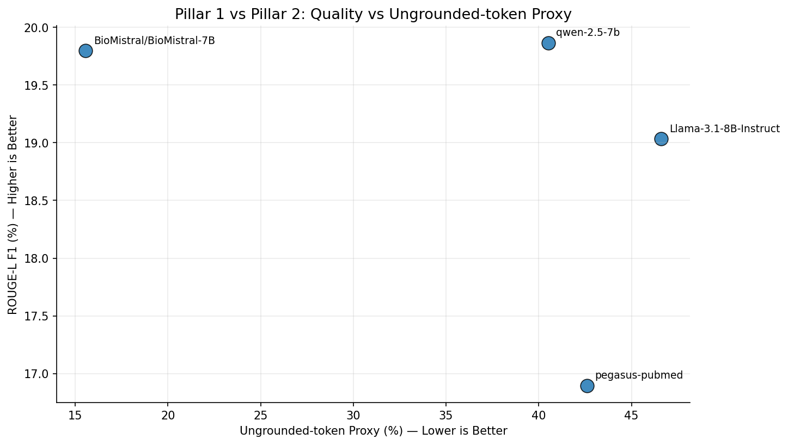
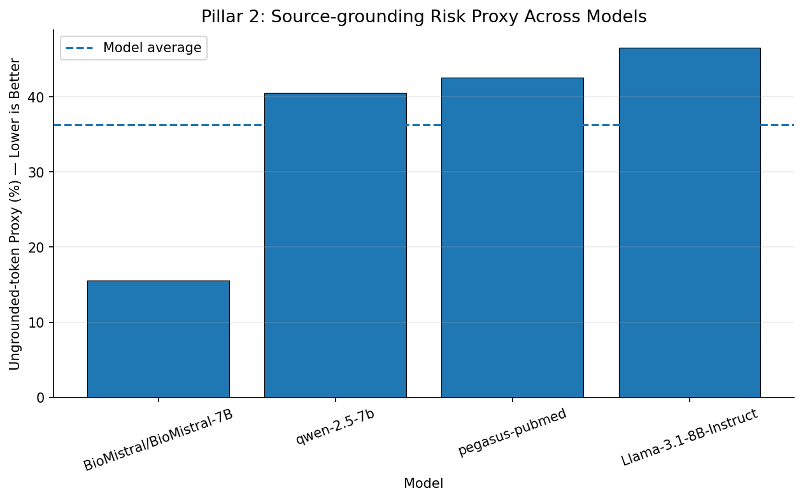
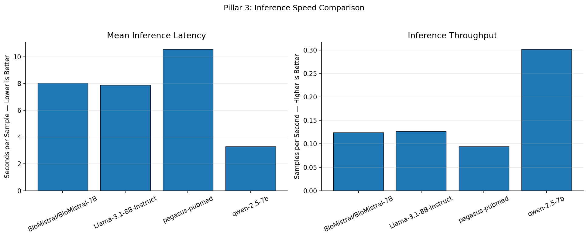

# Scientific Highlight Generation Benchmark
### FIRE MixSub-SciHigh | Quality, Source-Grounding Proxy, and Inference Efficiency

[](https://www.python.org/)
[](https://pytorch.org/)
[](https://huggingface.co/docs/transformers/)
[](https://colab.research.google.com/)
[](#evaluation-framework)

> **Project purpose:** compare scientific-highlight generation systems on the FIRE MixSub-SciHigh dataset by measuring reference similarity, lexical overlap with the source abstract, and inference efficiency.

---

## Table of contents

- [Project overview](#project-overview)
- [Dataset and task](#dataset-and-task)
- [Models and execution modes](#models-and-execution-modes)
- [Reproducibility and fair-comparison controls](#reproducibility-and-fair-comparison-controls)
- [Evaluation framework](#evaluation-framework)
- [How the metrics are calculated](#how-the-metrics-are-calculated)
- [Observed results](#observed-results-from-the-supplied-figures)
- [Figure gallery](#figure-gallery)
- [How to run](#how-to-run)
- [Output structure](#output-structure)
- [Limitations and interpretation](#limitations-and-interpretation)
- [Recommended next experiments](#recommended-next-experiments)

---

## Project overview

Scientific highlight generation takes a research-paper abstract and produces a short set of statements that communicate its central findings. A useful system should:

1. capture the key information in the reference highlights;
2. remain grounded in the supplied abstract rather than introducing unsupported details; and
3. generate outputs efficiently enough for practical use.

This benchmark organizes evaluation into three pillars:

| Pillar | What it asks | Main reported measure | Preferred direction |
|---|---|---|---|
| **1 — Reference quality** | Does the generated text resemble the human-written highlights? | ROUGE-L F1; target lexical F1 | Higher |
| **2 — Source overlap** | How much generated vocabulary overlaps with the source abstract? | Source lexical precision; ungrounded-token proxy | Higher source overlap / lower proxy |
| **3 — Inference efficiency** | How long does generation take, and how many examples can be processed per second? | Mean latency; sample throughput | Lower latency / higher throughput |

The second pillar is deliberately described as a **source-overlap or grounding proxy**. It is not a semantic fact-checker and must not be presented as a direct measurement of factual hallucinations.

## Dataset and task

The project uses the three FIRE MixSub-SciHigh CSV splits:

| Split | Expected file | Use |
|---|---|---|
| Training | `MixSub-SciHigh_train_FIRE.csv` | Available for model training or fine-tuning workflows |
| Validation | `MixSub-SciHigh_val_FIRE.csv` | Reference-based evaluation using `Abstract` and `Highlights` |
| Masked test | `MixSub-SciHigh_test_FIRE(Masked).csv` | Generate predictions from `Abstract`; references are not available for ordinary scoring |

Expected labelled columns:

- `Abstract`: source scientific abstract.
- `Highlights`: human-written reference highlights.

The masked test split is for prediction/submission, not for calculating reference-based ROUGE or target-overlap metrics unless gold references are separately supplied by the task organizer.

## Models and execution modes

The project README originally planned six model families. The figures supplied with this README currently show results for **four models**:

| Model shown in supplied results | Model identifier / family | Notes |
|---|---|---|
| BioMistral-7B | `BioMistral/BioMistral-7B` | Biomedical-domain model |
| Qwen 2.5 7B | `Qwen/Qwen2.5-7B-Instruct` | Instruction-tuned model |
| Llama 3.1 8B | `meta-llama/Llama-3.1-8B-Instruct` | Gated model; Hugging Face access approval required |
| Pegasus-PubMed | `google/pegasus-pubmed` | Encoder-decoder model specialized for biomedical summarization |

Other models in the original project plan include Gemma 2 2B and Phi-3 Mini. They are **not represented in the four supplied result figures** and are not included in the result interpretation below.

### Execution-mode transparency

The individual notebooks have not all used the same adaptation strategy. In particular, the recent BioMistral, Qwen, and Llama workflows were configured as zero-shot inference to reduce training time. A Gemma workflow was previously configured for QLoRA fine-tuning. Pegasus-PubMed may use a different encoder-decoder inference/training path.

For a scientifically valid comparison, each row in the final results table should be accompanied by its actual `evaluation_type`, fine-tuning status, quantization, checkpoint, sample count, and hardware. Do not describe all models as QLoRA fine-tuned unless the run metadata and training logs confirm that.

## Reproducibility and fair-comparison controls

The intended shared generation limits are:

| Setting | Value | Meaning |
|---|---:|---|
| `MAX_SOURCE_LENGTH` | 512 tokens | Maximum tokenized source length |
| `MAX_TARGET_LENGTH` | 128 tokens | Maximum number of newly generated tokens |

These limits standardize the input and output ceilings. They do **not** by themselves guarantee a fully controlled experiment. Record and, where possible, hold constant:

- exact validation examples and evaluation sample count;
- tokenizer truncation and special-token handling;
- decoding settings (`do_sample`, temperature, top-p, repetition penalty, etc.);
- model precision and quantization;
- GPU type, software versions, and device placement;
- whether model loading and warm-up are excluded from latency;
- whether latency is measured per example and includes tokenization or only generation.

For speed comparisons, use the same hardware and timing boundary. A T4 run and a different GPU run should not be compared as if they were directly equivalent.

## Evaluation framework

### Pillar 1 — Reference quality

**ROUGE-L precision, recall, and F1**

ROUGE-L uses the longest common subsequence (LCS) between a generated highlight and its human-written reference. It rewards overlap while taking token order into account.

Let:

- \(X\) be the generated text;
- \(Y\) be the reference highlight;
- \(LCS(X,Y)\) be the length of their longest common subsequence;
- \(|X|\) and \(|Y|\) be their token counts.

Then:

\[
P_{LCS}=\frac{LCS(X,Y)}{|X|},\qquad
R_{LCS}=\frac{LCS(X,Y)}{|Y|}
\]

\[
F1_{LCS}=\frac{2P_{LCS}R_{LCS}}{P_{LCS}+R_{LCS}}
\]

The implementation uses the `rouge-score` package with the `rougeL` scorer and stemming enabled. Per-example values are averaged over the evaluation set.

**Target lexical precision, recall, and F1**

A second, simpler overlap measure compares the sets of normalized whitespace-separated tokens in the generated highlight and reference. Text is lowercased, punctuation is removed, and repeated whitespace is collapsed.

For each example, let \(G\) be the set of generated tokens and \(R\) the set of reference tokens:

\[
P_{target}=\frac{|G\cap R|}{|G|},\qquad
R_{target}=\frac{|G\cap R|}{|R|}
\]

\[
F1_{target}=\frac{2P_{target}R_{target}}{P_{target}+R_{target}}
\]

Zero-denominator cases are handled as zero. This is a set-based lexical measure: it does not understand paraphrases, entailment, or scientific correctness.

### Pillar 2 — Source lexical overlap proxy

**Source lexical precision**

The same normalization and set-overlap procedure is applied between the generated highlight and its source abstract:

\[
P_{source}=\frac{|G\cap S|}{|G|}
\]

where \(S\) is the set of normalized source-abstract tokens.

**Ungrounded-token proxy**

The benchmark derives:

\[
Risk_{proxy}(\%)=(1-\overline{P_{source}})\times100
\]

A lower value means a smaller fraction of unique generated vocabulary is shared with the source abstract under this normalization.

**Critical interpretation:** this calculation cannot determine whether a statement is true, false, entailed, or contradicted. A valid paraphrase may use words absent from the abstract and be counted as “ungrounded”; conversely, a copied but misrepresented phrase may receive high overlap. The metric should therefore be named **ungrounded-token lexical proxy** or **source non-overlap proxy**, not factual hallucination rate.

### Pillar 3 — Inference efficiency

**Mean generation latency**

For each example, the notebook records elapsed wall-clock time around the generation call:

\[
\overline{T}=\frac{1}{N}\sum_{i=1}^{N}T_i
\]

The reported unit is seconds per sample. Whether tokenization and device-transfer time are included depends on the exact placement of the timer in each model notebook; this should be checked before cross-model claims.

**Total latency**

\[
T_{total}=\sum_{i=1}^{N}T_i
\]

**Sample throughput**

\[
Throughput_{samples/sec}=\frac{N}{T_{total}}
=\frac{1}{\overline{T}}
\]

This is examples per second, not generated tokens per second.

**Token throughput**

Some project documentation refers to tokens per second. That is a different measure:

\[
Throughput_{tokens/sec}=
\frac{\text{number of generated tokens}}{\text{generation time in seconds}}
\]

Do not label sample throughput as token throughput. The supplied comparison figure displays samples/second.

## How the metrics are achieved in the pipeline

1. Load the validation CSV and verify the `Abstract` and `Highlights` columns.
2. Tokenize/truncate the abstract to the shared source limit.
3. Generate a highlight with the model's configured prompt and decoding settings.
4. Record generation latency for that example.
5. Compare the generated highlight with the reference using ROUGE-L and target lexical overlap.
6. Compare generated vocabulary with the source abstract to calculate source lexical precision and its complementary proxy.
7. Average per-example quality/overlap metrics and aggregate latency/throughput.
8. Save model-level metrics as JSON and per-example outputs as CSV.
9. The master notebook reads the JSON files, builds a comparison table, and creates the plots.

The exact prompt and decoding parameters are model-notebook implementation details and should be reported from the corresponding notebook/configuration rather than assumed identical.

## Observed results from the supplied figures

The following values are **visual estimates read from the uploaded plots**, not exact values extracted from the raw benchmark JSON files. Use the JSON outputs to replace these approximations before publication.

| Model | ROUGE-L F1 (approx. %) | Ungrounded-token proxy (approx. %) | Mean latency (approx. s/sample) | Throughput (approx. samples/s) |
|---|---:|---:|---:|---:|
| BioMistral-7B | 19.8 | 15.5 | 8.05 | 0.124 |
| Qwen 2.5 7B | 19.86 | 40.5 | 3.30 | 0.303 |
| Llama 3.1 8B | 19.03 | 47.5 | 7.90 | 0.127 |
| Pegasus-PubMed | 16.90 | 42.5 | 10.55 | 0.094 |

### Interpretation of the plotted results

**Reference quality**
- Qwen 2.5 7B has the highest plotted ROUGE-L F1, approximately 19.9%.
- BioMistral-7B is very close, approximately 19.8%.
- Llama 3.1 8B is around 19.0%.
- Pegasus-PubMed is lowest in this displayed comparison, around 16.9%.

The plotted differences are small in absolute terms. Without per-example scores, confidence intervals, and a significance test, do not claim that the small Qwen/BioMistral gap is statistically significant.

**Source-overlap proxy**
- BioMistral-7B has the lowest proxy value (about 15.5%), indicating the greatest lexical overlap with its source abstract among the four plotted systems.
- Qwen is around 40.5%.
- Pegasus-PubMed is around 42.5%.
- Llama is highest at approximately 47.5%.

This does **not** prove BioMistral is factually safest. It only indicates stronger vocabulary overlap under the benchmark's lexical calculation.

**Inference efficiency**
- Qwen has the lowest plotted mean latency (about 3.3 seconds/sample) and highest sample throughput (about 0.303 samples/second).
- BioMistral and Llama are both around 8 seconds/sample.
- Pegasus-PubMed is slowest in the displayed figure, around 10.6 seconds/sample.

These observations are meaningful only if hardware, sample set, timer boundaries, and generation settings are comparable.

### Overall reading

On the four supplied plots, Qwen appears to offer the strongest **quality–speed** combination: highest displayed ROUGE-L F1 and fastest inference. BioMistral has the strongest **source lexical overlap** and nearly the same displayed ROUGE-L F1, but takes longer. Llama is slower and has the highest source non-overlap proxy in this set. Pegasus-PubMed is fastest neither nor highest in displayed ROUGE-L F1.

There is no single overall winner unless the project defines how quality, source overlap, and speed should be weighted. Avoid combining the three pillars into an arbitrary composite score without a pre-registered rationale.

## Figure gallery

### Figure 1 — Quality vs. inference latency


Higher on the y-axis and further left on the x-axis are preferred.

### Figure 2 — Quality vs. source-overlap proxy



Higher ROUGE-L and lower source non-overlap proxy are preferred. The x-axis is a lexical proxy, not a factual hallucination detector.

### Figure 3 — Source-overlap proxy comparison



Lower proxy values indicate more generated vocabulary shared with the abstract under the metric's normalization.

### Figure 4 — Inference latency and sample throughput



Lower latency and higher samples/second are preferred.

## How to run

### 1. Prepare Google Drive

Create this structure:

```text
MyDrive/
└── JU_Benchmark_Project/
    ├── Dataset/
    │   ├── MixSub-SciHigh_train_FIRE.csv
    │   ├── MixSub-SciHigh_val_FIRE.csv
    │   └── MixSub-SciHigh_test_FIRE(Masked).csv
    ├── checkpoints/
    └── results/
```

### 2. Run the model notebooks

Run the relevant model notebook(s) in Google Colab. Enable a GPU for model inference/training. Gated models such as Llama 3.1 require accepted model terms and an authorized Hugging Face token.

### 3. Collect benchmark outputs

Place each model's `benchmark_*.json` in the same `results/` folder. Keep the prediction CSVs for audit and task submission.

### 4. Run the master comparison notebook

Run `07_Master_Benchmark_Comparison_and_Visualizations.ipynb`. The master comparison is a CPU-side aggregation/plotting task and does not need a GPU.

## Output structure

```text
JU_Benchmark_Project/
├── Dataset/
├── checkpoints/
└── results/
    ├── benchmark_<model>.json
    ├── <model>_validation_predictions.csv
    ├── MixSub-SciHigh_test_predictions_<model>.csv
    ├── master_3pillar_benchmark_comparison.csv
    ├── master_benchmark_run_report.json
    └── plots/
        ├── quality_vs_inference_latency.png
        ├── quality_vs_hallucination_risk.png
        ├── hallucination_risk_ranking.png
        └── inference_speed_latency.png
```

This repository README includes a copy of the four figures supplied for interpretation under `assets/`.

## Limitations and interpretation

1. **Lexical overlap is not factual verification.** The source-overlap proxy cannot establish hallucination or entailment.
2. **ROUGE is a surface-overlap metric.** It may penalize correct paraphrases and does not fully assess scientific meaning.
3. **Results are approximate in this README.** The supplied plots were available, but raw JSON result files were not included with the materials used to prepare this analysis. Replace visual estimates with exact JSON values before a paper or final report is submitted.
4. **Only four models appear in the supplied figures.** The original plan lists six; Gemma 2 and Phi-3 Mini are not visible in these results.
5. **Training conditions may differ.** Zero-shot and fine-tuned runs must be labelled and analyzed separately.
6. **Runtime comparisons require matched conditions.** GPU type, quantization, software versions, decoding settings, timer boundaries, and evaluation sample count can change latency.
7. **No statistical uncertainty is shown.** Report per-example distributions, confidence intervals, and paired significance tests before making strong claims about small score differences.
8. **The 512/128 token limits are ceilings, not identical realized input/output lengths.** Record truncation rates and generated token counts where possible.

## Recommended next experiments

- Re-run all models on the exact same validation examples and sample count.
- Export the raw JSON metrics and per-example prediction CSVs for all models.
- Add bootstrap confidence intervals for ROUGE-L and source-overlap metrics.
- Add a human or model-assisted factuality evaluation based on claim-level entailment, with manual adjudication for a subset.
- Record actual generated-token throughput separately from samples/second.
- Report zero-shot and fine-tuned model groups separately.
- Include hardware and software metadata in every benchmark JSON.

---

## Citation and attribution

The dataset used by this project is FIRE MixSub-SciHigh. Cite the dataset/shared-task paper and the relevant model papers or model cards in the final research manuscript. Also cite the ROUGE implementation and software libraries used in the experiments. Add exact bibliographic entries only after verifying the authoritative publication details.

---

**Reproducibility note:** This README describes the metric logic and the results visible in the supplied plots. The raw benchmark JSON files and model notebooks remain the authoritative sources for exact scores, prompts, training settings, and run metadata.
