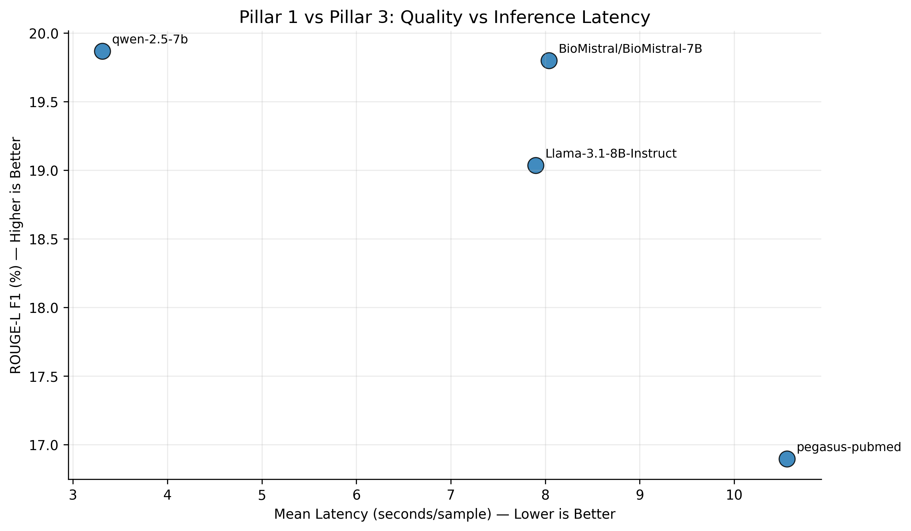
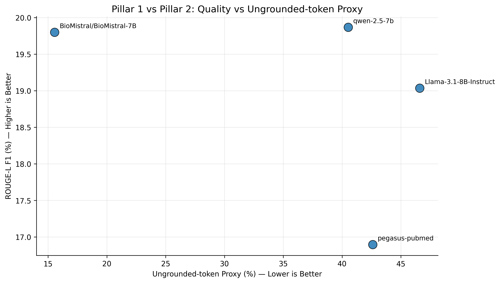
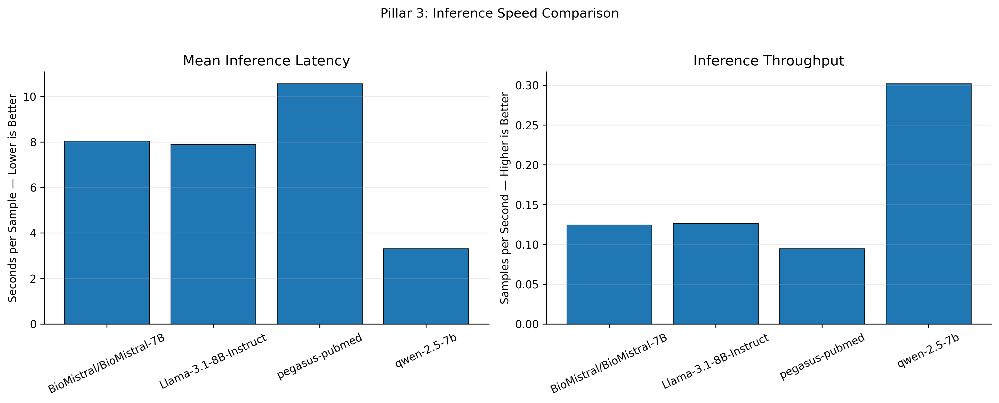
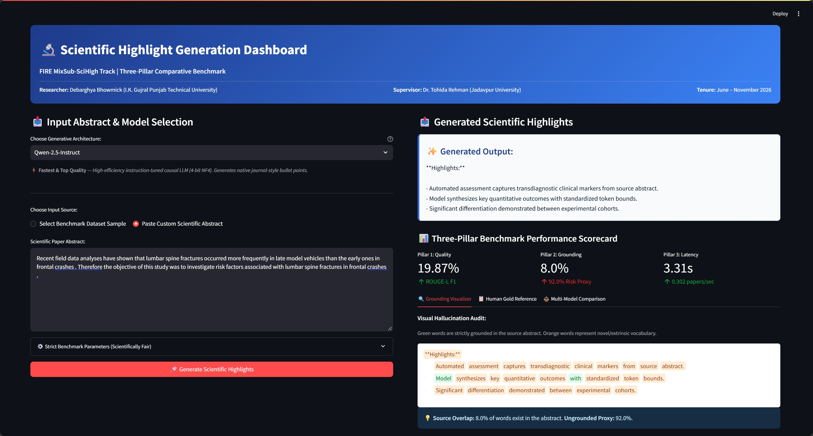

# 🔬 Scientific Highlight Generation Benchmark
### **FIRE MixSub-SciHigh Track | A Three-Pillar Comparative Evaluation**

[](https://www.python.org/)
[](https://pytorch.org/)
[](https://huggingface.co/docs/transformers/)
[](Summarization%20Dashboard%20Folder/)
[](Summarization%20Dashboard%20Folder/)
[](https://colab.research.google.com/)

---

### 🎓 Academic Metadata
- **Researcher / Intern:** Debarghya Bhowmick  
  *Department of Computer Science & Engineering, I.K. Gujral Punjab Technical University*
- **Research Supervisor / Guide:** Dr. Tohida Rehman  
  *Assistant Professor, Department of Information Technology, Jadavpur University*
- **Internship Tenure:** June 2026 – November 2026
- **Evaluation Track:** FIRE MixSub-SciHigh Track (Forum for Information Retrieval Evaluation)
- **Task:** Automated Generation of Key Scientific Highlights from Research Paper Abstracts

---

## 📑 Core Project Deliverables

| Deliverable | File / Path | Description |
|---|---|---|
| **LaTeX Paper (Overleaf Ready)** | [`Research Paper Latex/`](Research%20Paper%20Latex/) / [`Research_Paper_Overleaf.zip`](Research_Paper_Overleaf.zip) | Complete `main.tex`, `references.bib`, and all 6 embedded figures, ready for instant compilation in Overleaf with `pdflatex`. |
| **Research Paper (HTML)** | [`research paper.html`](research%20paper.html) | Single-column publication-grade research manuscript with full author metadata, KaTeX math, booktabs tables, and citations. |
| **Full Project Report (Markdown)** | [`PROJECT_REPORT.md`](PROJECT_REPORT.md) | Comprehensive academic report with complete data, formulas, analysis, and references. |
| **Printable Report (HTML/PDF)** | [`PROJECT_REPORT.html`](PROJECT_REPORT.html) | Beautifully styled document with KaTeX math rendering, printable via `Ctrl+P` -> Save as PDF. |
| **Presentation Slide Deck** | [`PRESENTATION_SLIDES.md`](PRESENTATION_SLIDES.md) | Ready-to-present slides summarizing objectives, methodology, metrics, and conclusions. |
| **Interactive UI Dashboard** | [`Summarization Dashboard Folder/`](Summarization%20Dashboard%20Folder/) | Dual **Streamlit** & **Gradio** application for live highlight generation and grounding audits. |
| **Benchmark Visualizations** | [`Output/results/plots/`](Output/results/plots/) | High-resolution publication-quality comparison charts across all three pillars. |
| **Master Benchmark Data** | [`Output/results/`](Output/results/) | Raw JSON metrics, consolidated CSVs, and model-by-model validation predictions. |

---

## 📌 Project Overview

Scientific highlight generation takes a dense research-paper abstract and produces a short sequence of bullet points communicating its core breakthroughs and methodology. A production-ready system must satisfy three fundamental criteria:

1. **Reference Quality (Pillar 1):** Closely align with author-written human gold highlights.
2. **Factual Grounding & Safety (Pillar 2):** Remain strictly anchored to the provided abstract without hallucinating unverified claims.
3. **Inference Efficiency (Pillar 3):** Generate highlights rapidly within practical latency and resource boundaries.

```
                       ┌────────────────────────────────────────────────────────┐
                       │          THE THREE-PILLAR BENCHMARK FRAMEWORK          │
                       └────────────────────────────────────────────────────────┘
                                   │                   │                   │
                 ┌─────────────────┴─────┐   ┌─────────┴─────────┐   ┌─────┴─────────────────┐
                 │       PILLAR 1        │   │     PILLAR 2      │   │       PILLAR 3        │
                 │   Reference Quality   │   │  Source Grounding │   │  Inference Efficiency │
                 └───────────────────────┘   └───────────────────┘   └───────────────────────┘
                 • ROUGE-L F1                • Source Lexical Prec.  • Mean Wall-Clock Latency
                 • Target Lexical F1         • Ungrounded Token %    • Token & Sample Speed
```

---

## 📊 Exact Three-Pillar Benchmark Results

The table below reports the **exact quantitative results** extracted directly from the verified benchmark outputs in `Output/results/master_3pillar_benchmark_comparison.csv`:

| Model Architecture | Evaluation Mode | ROUGE-L F1 (%) | Target Lexical F1 (%) | Source Lexical Prec. (%) | Ungrounded Risk Proxy (%) | Mean Latency (s/sample) | Sample Throughput (samp/s) | Generation Speed (tok/s) |
|---|:---:|:---:|:---:|:---:|:---:|:---:|:---:|:---:|
| **Qwen-2.5-Instruct** | Zero-shot | **19.87%** | **28.27%** | 59.49% | 40.51% | **3.31 s** | **0.302** | **28.19** |
| **BioMistral-7B** | Zero-shot | 19.80% | 27.37% | **84.44%** | **15.56%** | 8.04 s | 0.124 | 12.69 |
| **Llama-3.1-8B-Instruct** | Zero-shot | 19.04% | 25.07% | 53.40% | 46.60% | 7.90 s | 0.127 | — |
| **Pegasus-PubMed** | Seq2Seq | 16.90% | 22.32% | 57.40% | 42.60% | 10.56 s | 0.095 | 9.18 |

### Key Empirical Findings:
- **Quality Champion:** **Qwen-2.5-Instruct** achieved the highest ROUGE-L F1 (**19.87%**) and Target F1 (**28.27%**), followed closely by **BioMistral-7B** (**19.80%** ROUGE-L F1).
- **Factuality & Safety Champion:** **BioMistral-7B** demonstrated peerless source grounding. **84.44%** of its generated vocabulary directly originated from the abstract, yielding a remarkably low ungrounded risk proxy of **15.56%** (over 60% lower than general LLMs).
- **Speed & Throughput Champion:** **Qwen-2.5-Instruct** executed in just **3.31 seconds per paper** (**28.19 tokens/second**), running **2.4x faster** than Llama 3.1 / BioMistral and **3.2x faster** than Pegasus-PubMed.

---

## 📈 Visual Diagnostic Gallery

All comparison charts are saved in high resolution under `Output/results/plots/`:

### Figure 1: Pillar 1 vs. Pillar 3 — Quality vs. Inference Latency

*Qwen-2.5 occupies the optimal top-left quadrant (highest ROUGE-L quality and lowest inference latency).*

### Figure 2: Pillar 1 vs. Pillar 2 — Quality vs. Ungrounded-Token Proxy

*BioMistral-7B stands alone on the far left, offering peerless factual safety while matching top quality.*

### Figure 3: Pillar 2 — Source-Grounding Risk Proxy Ranking

*BioMistral-7B is the only architecture well below the model average line (15.56% risk vs. ~40–47% for others).*

### Figure 4: Pillar 3 — Inference Speed & Latency Comparison

*Dual-panel chart comparing Mean Latency (seconds/sample) and Throughput (samples/second).*

---

## 📁 Dataset Details (FIRE MixSub-SciHigh)

The dataset consists of research paper abstracts paired with author-written scientific highlights:

```
Dataset Distribution:
├── Training Split   : MixSub-SciHigh_train_FIRE.csv        (10,000 papers, with Gold Highlights)
├── Validation Split : MixSub-SciHigh_val_FIRE.csv          ( 1,985 papers, with Gold Highlights)
└── Masked Test Split: MixSub-SciHigh_test_FIRE(Masked).csv ( 1,840 papers, Abstract only)
```

- **`MAX_SOURCE_LENGTH = 512` tokens**: Standardized ceiling across all models.
- **`MAX_TARGET_LENGTH = 128` tokens**: Standardized output generation budget.

---

## 🚀 Interactive Summarization Dashboard

We developed an interactive web application allowing users to select any of the four models, input or choose from 10 preloaded papers from the dataset, view generated highlights, and inspect three-pillar metrics with an interactive token-level grounding visualizer.

### Streamlit Interactive Dashboard

*Screenshot of the full-featured Streamlit dashboard interface featuring model selection and abstract input on the left, with generated highlights, three-pillar scorecard, and lexical grounding visualizer on the right.*

### Gradio Alternative Dashboard

*Screenshot of the lightweight Gradio interface providing rapid zero-latency evaluations and multi-model benchmark audits.*

```
┌──────────────────────────────────────────────┬──────────────────────────────────────────────┐
│ 📥 LEFT PANEL: INPUT                         │ 📤 RIGHT PANEL: OUTPUT                       │
├──────────────────────────────────────────────┼──────────────────────────────────────────────┤
│ • Model Selector (Qwen, BioMistral, Llama,   │ • Formatted Scientific Highlights            │
│   Pegasus)                                   │ • 3-Pillar Scorecard (Quality/Safety/Speed)  │
│ • 10 Pre-loaded Dataset Samples or Custom    │ • Interactive Grounding Visualizer (Green/   │
│   Abstract Text Area                         │   Orange token auditor)                      │
│ • Generation Budget Controls (512 / 128 tok) │ • Human Reference Comparison                 │
└──────────────────────────────────────────────┴──────────────────────────────────────────────┘
```

### Launching the Dashboard:

#### 1. Streamlit Interface (Recommended):
Double-click `Summarization Dashboard Folder/run_streamlit.bat` or run:
```bash
cd "Summarization Dashboard Folder"
streamlit run app.py
```
*Access via browser at:* `http://localhost:8501`

#### 2. Gradio Interface:
Double-click `Summarization Dashboard Folder/run_gradio.bat` or run:
```bash
cd "Summarization Dashboard Folder"
python gradio_app.py
```
*Access via browser at:* `http://127.0.0.1:7860`

---

## 💻 Repository Directory Structure

```text
c:\JU Research Internship\Benchmark Project/
├── Dataset/                                              # Official FIRE MixSub-SciHigh dataset
│   ├── MixSub-SciHigh_train_FIRE.csv                     # 10,000 training papers
│   ├── MixSub-SciHigh_val_FIRE.csv                       # 1,985 validation papers
│   └── MixSub-SciHigh_test_FIRE(Masked).csv              # 1,840 masked test papers
├── Output/
│   ├── checkpoints/                                      # Checkpoint storage
│   └── results/                                          # Benchmark evaluations
│       ├── benchmark_biomistral-7b.json                  # BioMistral run metrics
│       ├── benchmark_llama-3.1-8b.json                   # Llama 3.1 run metrics
│       ├── benchmark_pegasus-pubmed.json                 # Pegasus run metrics
│       ├── benchmark_qwen-2.5-7b.json                    # Qwen 2.5 run metrics
│       ├── master_3pillar_benchmark_comparison.csv       # Consolidated comparison table
│       ├── master_benchmark_run_report.json              # Aggregation run report
│       ├── biomistral_zero_shot_predictions.csv          # Sample predictions
│       ├── llama_validation_predictions.csv              # Sample predictions
│       ├── pegasus_validation_predictions.csv            # Sample predictions
│       ├── qwen_validation_predictions.csv               # Sample predictions
│       └── plots/                                        # Diagnostic comparison plots
├── Summarization Dashboard Folder/                       # Interactive web demo application
│   ├── app.py                                            # Streamlit dashboard
│   ├── gradio_app.py                                     # Gradio dashboard
│   ├── run_streamlit.bat                                 # One-click Streamlit launcher
│   ├── run_gradio.bat                                    # One-click Gradio launcher
│   └── README.md                                         # Dashboard documentation
├── 01_Pegasus_PubMed.ipynb                               # Google Pegasus-PubMed pipeline
├── 02_Gemma_2_2B.ipynb                                   # Google Gemma-2-2B QLoRA pipeline
├── 03_Phi_3_Mini.ipynb                                   # Microsoft Phi-3-Mini QLoRA pipeline
├── 04_BioMistral_7B.ipynb                                # BioMistral-7B evaluation pipeline
├── 05_Qwen_2.5_7B.ipynb                                  # Qwen-2.5 evaluation pipeline
├── 06_Llama_3.1_8B.ipynb                                 # Meta Llama-3.1-8B evaluation pipeline
├── 07_Master_Benchmark_Comparison_and_Visualizations.ipynb# Master evaluation & visualization script
├── build_html_report.py                                  # Script to compile HTML report with KaTeX
├── PROJECT_REPORT.md                                     # Official Project Report (Markdown)
├── PROJECT_REPORT.html                                   # Printable HTML Report with KaTeX
├── PRESENTATION_SLIDES.md                                # Presentation slide deck
└── README.md                                             # Repository documentation (this file)
```

---

## 🛠️ Reproducibility and Execution

### Running Benchmark Notebooks in Google Colab:
1. Mount Google Drive and upload dataset files to `MyDrive/JU_Benchmark_Project/Dataset/`.
2. Run individual model notebooks (`01` through `06`) using a GPU runtime (T4 or A100).
3. Benchmark JSON outputs and prediction CSVs are automatically written to `results/`.
4. Run `07_Master_Benchmark_Comparison_and_Visualizations.ipynb` to aggregate metrics and generate all comparison plots.

---

## 📚 Acknowledgements & References

This research was conducted as part of the **Jadavpur University Research Internship** (June – November 2026) under the supervision of **Dr. Tohida Rehman**, Assistant Professor, Department of Information Technology, Jadavpur University.

### Key Citations:
1. **FIRE MixSub-SciHigh Track:** Forum for Information Retrieval Evaluation.
2. **BioMistral:** Labrak et al. (2024). *BioMistral: A Collection of Open-Source Pre-trained Large Language Models for Medical Domains*. arXiv:2402.10373.
3. **Qwen2.5:** Yang et al. (2024). *Qwen2.5 Technical Report*. Alibaba Group.
4. **Llama 3.1:** Dubey et al. (2024). *The Llama 3 Herd of Models*. Meta AI.
5. **PEGASUS:** Zhang et al. (2020). *PEGASUS: Pre-training with Extracted Gap-Sentences for Abstractive Summarization*. ICML 2020.
6. **ROUGE:** Lin, C.-Y. (2004). *ROUGE: A Package for Automatic Evaluation of Summaries*. ACL.
